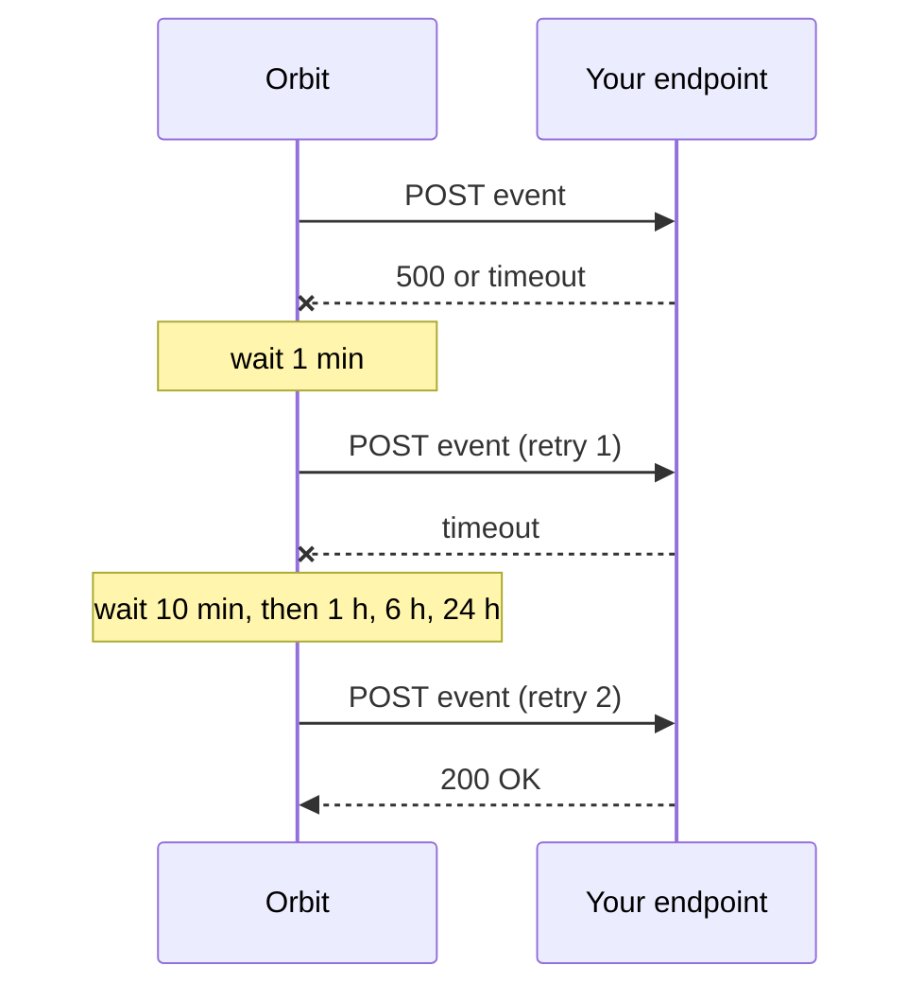

Orbit sends a `POST` to your endpoint whenever something you care about changes. Set a default URL under **Account → Webhooks**, or set `notify_url` on a single booking.

## Events

| Event                                                    | Sent when                                              |
| :------------------------------------------------------- | :----------------------------------------------------- |
| [`booking.confirmed`](/reference/bookingconfirmed)       | Orbit approves your manifest and the booking is final  |
| [`launch.status_changed`](/reference/launchstatuschanged) | A launch you’re booked on changes state, such as `go` to `scrubbed` |

Every event has the same envelope:

```json
{
  "id": "evt_8Wq2Hd",
  "type": "launch.status_changed",
  "created_at": "2026-12-09T03:12:00Z",
  "data": { "launch_id": "lch_9Kd4Mw", "from": "go", "to": "scrubbed", "reason": "Upper-level winds" }
}
```

## Check the signature

Each request carries an `Orbit-Signature` header: a timestamp and an HMAC-SHA256 of `timestamp.body`, signed with your webhook secret. Reject anything that doesn’t match, or that is more than five minutes old.

The recipe walks through a complete Express handler line by line:

<Recipe slug="verify-webhook-signatures" title="Verify webhook signatures" />

```javascript Node.js
import crypto from 'node:crypto';

export function verify(rawBody, header, secret) {
  const { t, v1 } = Object.fromEntries(header.split(',').map(p => p.split('=')));
  if (Math.abs(Date.now() / 1000 - Number(t)) > 300) return false;

  const expected = crypto.createHmac('sha256', secret).update(`${t}.${rawBody}`).digest('hex');
  return crypto.timingSafeEqual(Buffer.from(expected), Buffer.from(v1));
}
```
```python Python
import hashlib
import hmac
import time

def verify(raw_body: bytes, header: str, secret: str) -> bool:
    parts = dict(p.split("=", 1) for p in header.split(","))
    if abs(time.time() - int(parts["t"])) > 300:
        return False
    signed = f'{parts["t"]}.'.encode() + raw_body
    expected = hmac.new(secret.encode(), signed, hashlib.sha256).hexdigest()
    return hmac.compare_digest(expected, parts["v1"])
```
```go Go
func Verify(rawBody []byte, header, secret string) bool {
	parts := map[string]string{}
	for _, p := range strings.Split(header, ",") {
		kv := strings.SplitN(p, "=", 2)
		parts[kv[0]] = kv[1]
	}
	mac := hmac.New(sha256.New, []byte(secret))
	mac.Write([]byte(parts["t"] + "."))
	mac.Write(rawBody)
	expected := hex.EncodeToString(mac.Sum(nil))
	return hmac.Equal([]byte(expected), []byte(parts["v1"]))
}
```

<Callout icon="⚠️" theme="warn">
  Verify against the **raw** request body. Parsing the JSON and serializing it again changes the bytes, so the signature won’t match.
</Callout>

## Retries

Respond with any `2xx` within ten seconds. Otherwise Orbit retries with backoff:



After five failed retries the event is marked failed. You can resend it from **Account → Webhooks**.

<Accordion title="How this page is built" icon="fa-wand-magic-sparkles">
  * A **table** whose cells link to webhook pages in the API Reference. Those pages come from the `webhooks` section of the OpenAPI 3.1 file.
  * **Code tabs** in three languages
  * A **Recipe** embed for the full handler
  * A **warning** Callout
  * A **Mermaid** sequence diagram with notes and failed calls
</Accordion>
