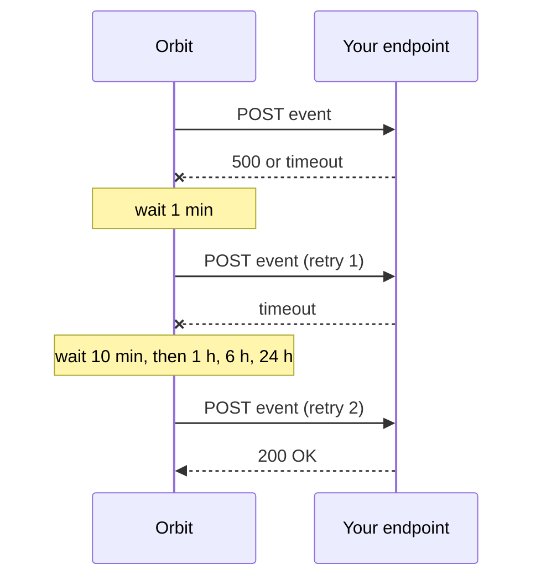

每当您关注的内容发生变动时，Orbit 都会向您的端点发送一个 `POST` 请求。您可以在 **Account → Webhooks** 下设置默认 URL，或在单个预订中设置 `notify_url`。

## 事件 {#events}

| 事件                                                        | 触发时机                                |
| :-------------------------------------------------------- | :---------------------------------- |
| [`booking.confirmed`](/reference/bookingconfirmed)        | Orbit 批准了您的清单且预订已最终确认               |
| [`launch.status_changed`](/reference/launchstatuschanged) | 您预订的发射状态发生变更，例如从 `go` 变为 `scrubbed` |

每个事件都具有相同的信封结构：

```json
{
  "id": "evt_8Wq2Hd",
  "type": "launch.status_changed",
  "created_at": "2026-12-09T03:12:00Z",
  "data": { "launch_id": "lch_9Kd4Mw", "from": "go", "to": "scrubbed", "reason": "Upper-level winds" }
}
```

## 验证签名 {#check-the-signature}

每个请求都带有一个 `Orbit-Signature` 请求头：包含时间戳以及使用您的 Webhook 密钥对 `timestamp.body` 计算的 HMAC-SHA256 签名。请拒绝任何不匹配或超过五分钟的请求。

该操作指南逐行演示了一个完整的 Express 处理程序：

<Recipe slug="verify-webhook-signatures" title="验证 Webhook 签名" />

```javascript Node.js
import crypto from 'node:crypto';

export function verify(rawBody, header, secret) {
  const { t, v1 } = Object.fromEntries(header.split(',').map(p => p.split('=')));
  if (Math.abs(Date.now() / 1000 - Number(t)) > 300) return false;

  const expected = crypto.createHmac('sha256', secret).update(`${t}.${rawBody}`).digest('hex');
  return crypto.timingSafeEqual(Buffer.from(expected), Buffer.from(v1));
}
```
```python Python
import hashlib
import hmac
import time

def verify(raw_body: bytes, header: str, secret: str) -> bool:
    parts = dict(p.split("=", 1) for p in header.split(","))
    if abs(time.time() - int(parts["t"])) > 300:
        return False
    signed = f'{parts["t"]}.'.encode() + raw_body
    expected = hmac.new(secret.encode(), signed, hashlib.sha256).hexdigest()
    return hmac.compare_digest(expected, parts["v1"])
```
```go Go
func Verify(rawBody []byte, header, secret string) bool {
	parts := map[string]string{}
	for _, p := range strings.Split(header, ",") {
		kv := strings.SplitN(p, "=", 2)
		parts[kv[0]] = kv[1]
	}
	mac := hmac.New(sha256.New, []byte(secret))
	mac.Write([]byte(parts["t"] + "."))
	mac.Write(rawBody)
	expected := hex.EncodeToString(mac.Sum(nil))
	return hmac.Equal([]byte(expected), []byte(parts["v1"]))
}
```

<Callout icon="⚠️" theme="warn">
  请针对**原始**请求体进行验证。解析 JSON 并再次序列化会改变字节，从而导致签名不匹配。
</Callout>

## 重试机制 {#retries}

请在十秒内返回任意 `2xx` 状态码。否则 Orbit 将采用退避策略进行重试：



在五次重试失败后，该事件将被标记为失败。您可以从 **Account → Webhooks** 重新发送。

<Accordion title="本页面的构建方式" icon="fa-wand-magic-sparkles">
  - 一个**表格**，其单元格链接到 API 参考中的 Webhook 页面。这些页面来自 OpenAPI 3.1 文件的 `webhooks` 部分。
  - 三种语言的**代码选项卡**
  - 用于完整处理程序的 **Recipe** 嵌入组件
  - 一个**警告**提示框
  - 包含备注和失败调用的 **Mermaid** 时序图
</Accordion>
