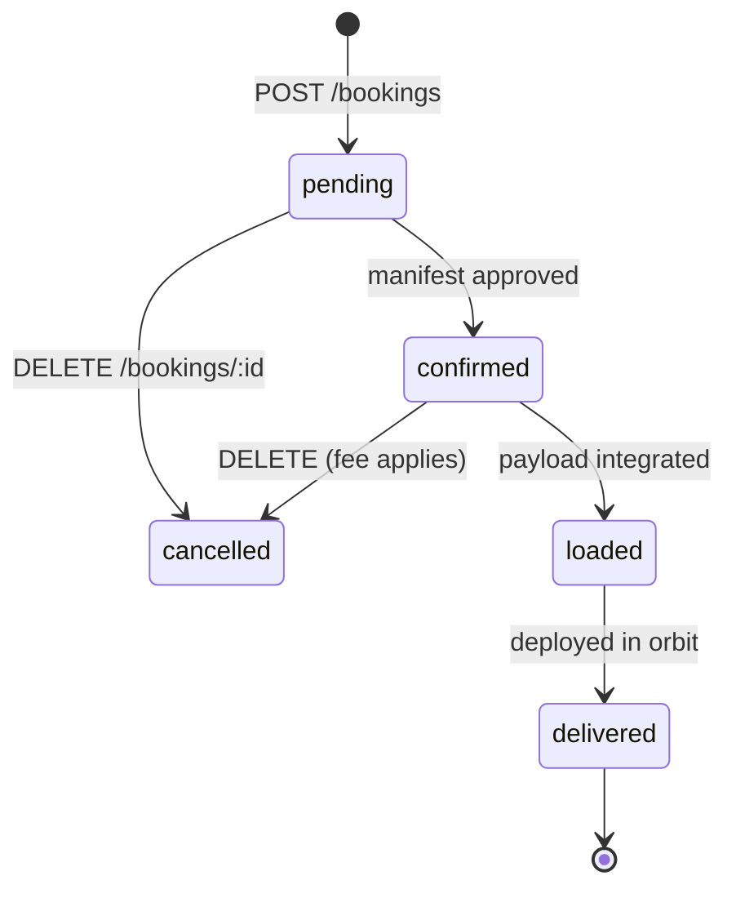
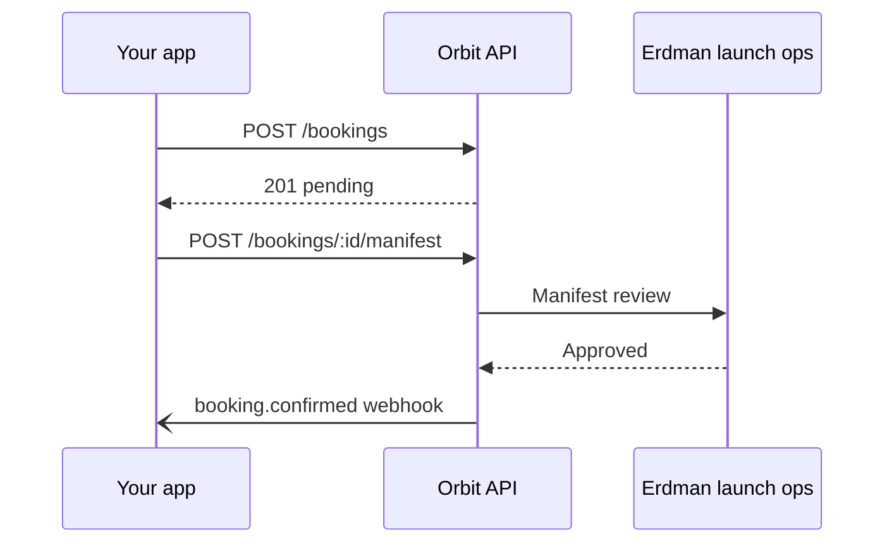

Orbit 包含四个基本组成部分。

| 概念       | 说明                      | ID 前缀  |
| :------- | :---------------------- | :----- |
| **发射**   | 单个运载工具的一次飞行，包含发射窗口和载货能力 | `lch_` |
| **预订**   | 您在某次发射中预留的空间            | `bkg_` |
| **有效载荷** | 您要发射的物品：卫星或散装货物         | `pld_` |
| **舱单**   | 描述您货物的已签署文件             | 不适用    |

## 预订的生命周期 {#the-life-of-a-booking}

预订会经历以下状态。每一步您都会收到一个 webhook。

## 谁与谁通信 {#who-talks-to-whom}

## 飞行目的地 {#where-we-fly}

Orbit 将有效载荷运送至 <Glossary>LEO</Glossary>、<Glossary>SSO</Glossary>、<Glossary>MEO</Glossary> 和 <Glossary>GEO</Glossary>。运载工具能向各个轨道运送多少质量取决于 <Glossary>delta-v</Glossary>。将光标悬停在任意带下划线的术语上可查看其含义。点击下方轨道可进行对比。

<OrbitViz highlight="sso" />

## 发射窗口 {#launch-windows}

每次发射都有一个 <Glossary>launch window</Glossary>：即运载工具飞往其目标轨道的时间段。如果受到天气或技术问题的影响，发射状态将变为 `hold` 或 `scrubbed`。被取消的预订可免费顺延至同一运载工具的下一次发射。

## 常见问题 {#faq}

<Accordion title="预订后我可以更改有效载荷吗？" icon="fa-box">
  有效载荷本身不可更改。其质量和目标轨道决定了价格和发射安排，因此请取消后重新预订。您可以随时通过 [更新预订](/reference/updatebooking) 更改保险等级和 webhook URL。
</Accordion>

<Accordion title="如果发射被中止会怎样？" icon="fa-cloud-bolt">
  您的预订将保持 `confirmed` 状态，并顺延至下一个窗口。您将收到包含具体原因的 `launch.status_changed` webhook。
</Accordion>

<Accordion title="是否有沙箱环境？" icon="fa-flask">
  是的。测试密钥（`ok_test_`）绝不会向您扣费，并且 API 参考中的 **沙箱** 服务器会回显您的请求，以便您可以试用每个端点。
</Accordion>

<Accordion title="本页面的构建方式" icon="fa-wand-magic-sparkles">
  - 包含粗体文本和行内代码的 Markdown **表格**
  - 以文本形式编写的两个 **Mermaid** 图表：状态图和时序图
  - **词汇表**术语：悬停可查看其定义。每个术语在项目的词汇表中仅定义一次
  - [Orbit Viz](/docs/orbit-viz)，一个 SVG 动画**自定义组件**
  - 带有 Font Awesome 图标的**折叠面板**，用作常见问题解答
  - 直接跳转至 API 参考端点的链接
</Accordion>
