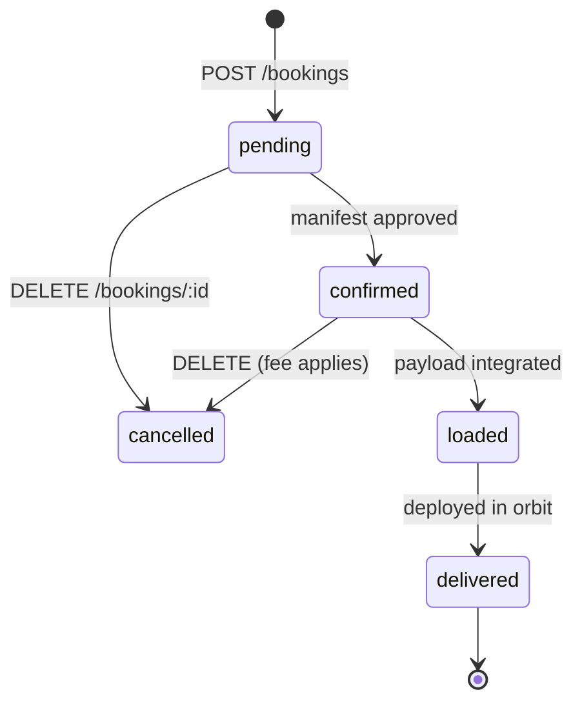
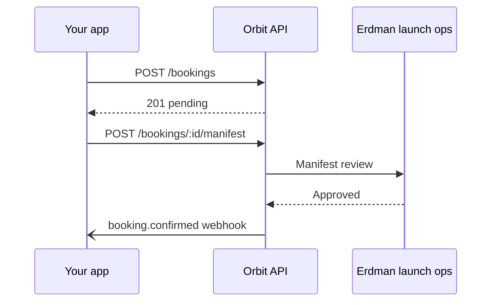

Orbit has four building blocks.

| Concept      | What it is                                                         | ID prefix |
| :----------- | :----------------------------------------------------------------- | :-------- |
| **Launch**   | One flight of one vehicle, with a launch window and cargo capacity | `lch_`    |
| **Booking**  | Your reserved space on a launch                                    | `bkg_`    |
| **Payload**  | What you’re flying: a satellite or bulk cargo                      | `pld_`    |
| **Manifest** | The signed document that describes your cargo                      | n/a       |

## The life of a booking

A booking moves through these states. You get a webhook at each step.

## Who talks to whom

## Launch windows

Every launch has a **window**: the span of time when the vehicle can fly to its target orbit. If weather or a technical issue gets in the way, the launch goes to `hold` or `scrubbed`. A scrubbed booking rolls to the next launch on the same vehicle for free.

## FAQ

<Accordion title="Can I change my payload after booking?" icon="fa-box">
  Not the payload itself. Its mass and target orbit decide the price and the launch, so cancel and book again. You can change the insurance tier and the webhook URL any time with [Update a booking](/reference/updatebooking).
</Accordion>

<Accordion title="What happens if a launch scrubs?" icon="fa-cloud-bolt">
  Your booking stays `confirmed` and moves to the next window. You get a `launch.status_changed` webhook with the reason.
</Accordion>

<Accordion title="Is there a sandbox?" icon="fa-flask">
  Yes. Test keys (`ok_test_`) never charge you, and the **Sandbox** server in the API Reference echoes your request back so you can try every endpoint.
</Accordion>

<Accordion title="How this page is built" icon="fa-wand-magic-sparkles">
  * A Markdown **table** with bold text and inline code
  * Two **Mermaid** diagrams written as text: a state diagram and a sequence diagram
  * **Accordions** with Font Awesome icons, used as an FAQ
  * Links straight to API Reference endpoints
</Accordion>
