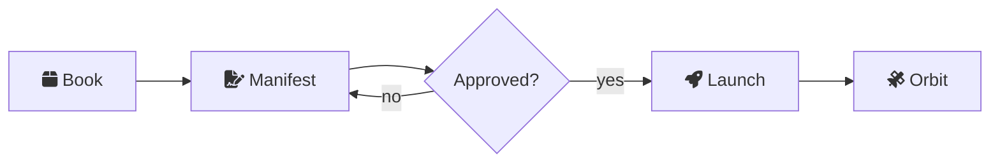
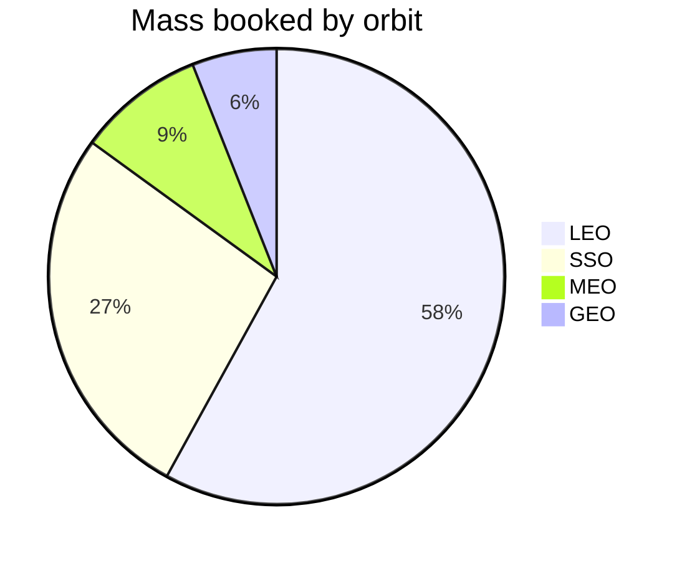

This page shows every native block in ReadMe’s editor, in the order of the `/` menu. Open it in the editor to see how each one is written.

## Text

Paragraphs support **bold**, *italic*, ~~strikethrough~~, `inline code`, [internal links](/docs/quickstart), [external links](https://readme.com) and emoji 🚀🛰️🌍. A line can end with a hard break  
like this one.

### A level-3 heading

#### A level-4 heading

Every heading gets an anchor link and an entry in the table of contents on the right.

***

## Lists

* Bulleted lists
  * can nest
    * as deep as you need
* and mix in `code` or **bold**

1. Numbered lists
2. count for you
   1. and nest too

* [x] Checklists show what’s done
* [ ] and what isn’t

## Blockquote

> The Earth is the cradle of humanity, but one cannot live in the cradle forever.
>
> — Konstantin Tsiolkovsky

## Callouts

<Callout icon="📘" theme="info">
  ### Info

  For context and tips.
</Callout>

<Callout icon="👍" theme="okay">
  ### Success

  For good news and confirmations.
</Callout>

<Callout icon="⚠️" theme="warn">
  ### Warning

  For things that can go wrong.
</Callout>

<Callout icon="❗️" theme="error">
  ### Error

  For things that will go wrong.
</Callout>

<Callout icon="🪐" theme="default">
  The default theme takes any emoji as its icon, and the title is optional.
</Callout>

## Code

A single block with a language and a title:

```yaml orbit.config.yaml
region: us-east
default_insurance: standard
webhooks:
  url: https://example.com/hooks/orbit
  events: [booking.confirmed, launch.status_changed]
```

Back-to-back blocks become tabs:

```shell cURL
curl "https://api.us-east.orbit.erdman.example/v1/launches" -H "X-Orbit-Key: $ORBIT_KEY"
```
```javascript Node.js
const launches = await orbit.launches.list({ minCapacityKg: 4 });
```
```python Python
launches = orbit.launches.list(min_capacity_kg=4)
```
```ruby Ruby
launches = Orbit::Launch.list(min_capacity_kg: 4)
```

## Tables

| Vehicle         | Stages | Reusable | Payload to LEO |
| :-------------- | :----: | :------: | -------------: |
| `wren`          |   2    |    ✅    |         900 kg |
| `kestrel`       |   2    |    ✅    |       4,000 kg |
| `kestrel-heavy` |   3    |    ✅    |       6,400 kg |

## Images

<Image align="center" width="70%" border="true" src="https://files.readme.io/37cb006440784bfafda1fb8b3ba62b8e2196055285ddc90e99f082bdf9937ccc-5647793d-6fa1-450f-a30c-1716a863f7cf.png" alt="Erdman Industries logo" caption="Images can be aligned, resized, bordered and captioned. Click to zoom." />

## Mermaid diagrams





## Accordion

<Accordion title="Click to expand" icon="fa-circle-info">
  Accordions hide detail until a reader wants it. They can hold any Markdown, including code:

  ```json
  { "status": "go" }
  ```
</Accordion>

## Tabs

<Tabs>
  <Tab title="Wren" icon="fa-feather">
    Small and quick. Up to 900 kg to low Earth orbit.
  </Tab>

  <Tab title="Kestrel" icon="fa-rocket">
    The workhorse. Up to 4,000 kg.
  </Tab>

  <Tab title="Kestrel Heavy" icon="fa-rocket-launch">
    Three cores and 6,400 kg to LEO.
  </Tab>
</Tabs>

## Columns

<Columns layout="auto">
  <Column>
    **Plan**

    Pick a launch window and a vehicle.
  </Column>

  <Column>
    **Book**

    Reserve space and upload the manifest.
  </Column>

  <Column>
    **Fly**

    Follow telemetry all the way to orbit.
  </Column>
</Columns>

## Cards

<Cards columns="3">
  <Card title="Card" href="/docs/quickstart" icon="fa-rocket" iconColor="#2F7BF5">
    A card with a link, an icon and an icon color.
  </Card>

  <Card title="With a badge" href="/docs/webhooks" icon="fa-satellite-dish" badge="New">
    Badges call out something fresh.
  </Card>

  <Card title="Tile" href="/reference/listlaunches" icon="fa-code" kind="tile">
    The tile style is more compact.
  </Card>
</Cards>

## Embeds

A YouTube video:

<Embed url="https://www.youtube.com/watch?v=wbSwFU6tY1c" title="Falcon Heavy Test Flight" typeOfEmbed="youtube" />

Any page in an iframe, like a map of the launch coast:

<Embed url="https://www.openstreetmap.org/export/embed.html?bbox=-80.70%2C28.40%2C-80.50%2C28.65&layer=mapnik" title="Launch coast map" typeOfEmbed="iframe" height="360" />

A link preview:

<Embed url="https://readme.com" title="ReadMe: beautiful documentation made easy" />

## Custom HTML

<HTMLBlock>{`
<div style="display:flex;align-items:center;gap:16px;padding:16px 20px;border-radius:12px;background:linear-gradient(90deg,#19C3F5,#2F7BF5 50%,#7B3FF2);color:#fff;font-family:inherit">
  <span style="font-size:32px">🚀</span>
  <div>
    <div style="font-weight:700;font-size:16px">Mission patch: Polaris Run</div>
    <div style="opacity:.9;font-size:13px">Raw HTML and CSS work too, for anything Markdown can’t do.</div>
  </div>
</div>
`}</HTMLBlock>

## Reusable content

The box below is one snippet shared by several pages. Edit it once and every page updates:

<OrbitHelp />

## Fine print

Orbital velocity in low Earth orbit is about 7.8 km/s[^1].

[^1]: Fast enough to go around the planet in roughly 90 minutes.
