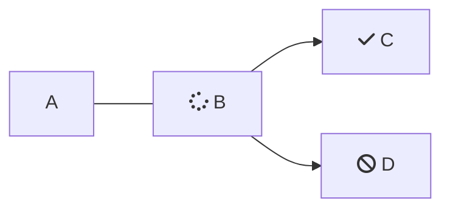

<Accordion title="" icon="fa-info-circle">

</Accordion>

<Callout icon="📘" theme="info">

</Callout>

<Cards>
  <Card title="Card One" icon="fa-rocket">

  </Card>

  <Card title="Card Two" icon="fa-code">

  </Card>

  <Card title="Card Three" icon="fa-comments">

  </Card>
</Cards>

```text
```

<Columns layout="fixed">
  <Column>

  </Column>

  <Column>

  </Column>
</Columns>

<HTMLBlock>{`

`}</HTMLBlock>

***




<Recipe  />

|   |   |   |
| - | - | - |
|   |   |   |
|   |   |   |

<Tabs>
  <Tab title="Tab 1">

  </Tab>

  <Tab title="Tab 2">

  </Tab>
</Tabs>

test
