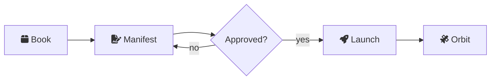
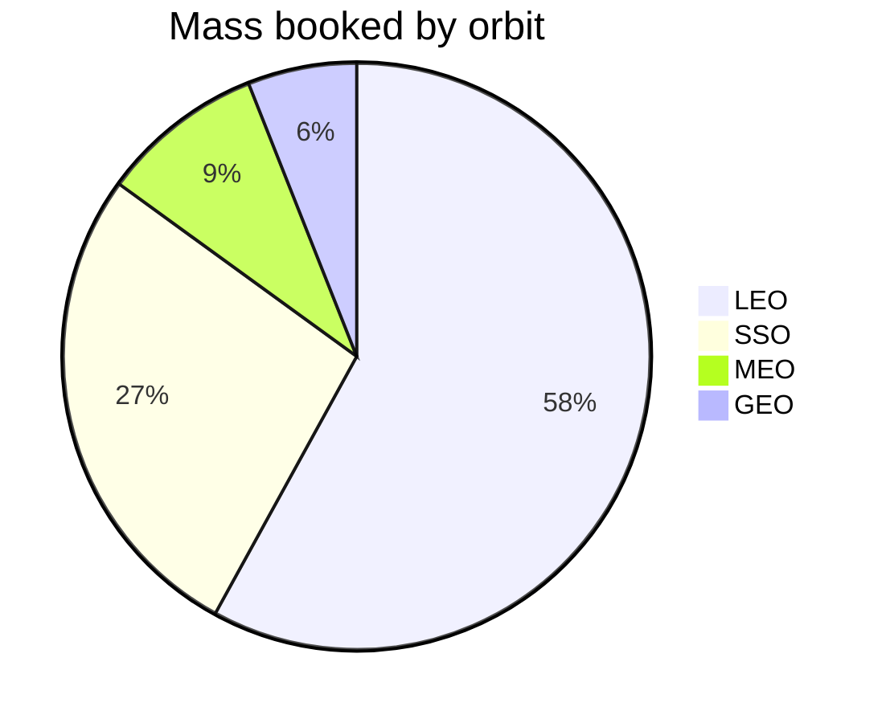

本页面展示了 ReadMe 编辑器中的所有原生区块，按 `/` 菜单的顺序排列。在编辑器中打开它即可查看每个区块的编写方式。

## 文本 {#text}

段落支持**粗体**、_斜体_、~~删除线~~、`inline code`、[内部链接](/docs/quickstart)、[外部链接](https://readme.com)以及表情符号 🚀🛰️🌍。行尾可以添加硬换行<br />就像这样。

### 三级标题 {#a-level-3-heading}

#### 四级标题 {#a-level-4-heading}

每个标题都会获得一个锚点链接，并在右侧的目录中生成一个对应条目。

***

## 列表 {#lists}

- 无序列表
  - 可以嵌套
    - 按需深入多层
- 并混入 `code` 或**粗体**

1. 有序列表
2. 自动为您编号
   1. 同样支持嵌套

- [x] 任务清单可展示已完成的事项
- [ ] 以及未完成的事项

## 块引用 {#blockquote}

> 地球是人类的摇篮，但人类不可能永远生活在摇篮中。
>
> — 康斯坦丁·齐奥尔科夫斯基

## 提示框 {#callouts}

<Callout icon="📘" theme="info">
  ### 信息 {#info}

  用于背景信息和操作技巧。
</Callout>

<Callout icon="👍" theme="okay">
  ### 成功 {#success}

  用于好消息和确认操作。
</Callout>

<Callout icon="⚠️" theme="warn">
  ### 警告 {#warning}

  用于提示可能出现的问题。
</Callout>

<Callout icon="❗️" theme="error">
  ### 错误 {#error}

  用于提示必然会导致错误的情况。
</Callout>

<Callout icon="🪐" theme="default">
  默认主题支持使用任何表情符号作为图标，且标题为可选。
</Callout>

## 代码 {#code}

包含语言和标题的单个代码块：

```yaml orbit.config.yaml
region: us-east
default_insurance: standard
webhooks:
  url: https://example.com/hooks/orbit
  events: [booking.confirmed, launch.status_changed]
```

连续的代码块会转换为标签页：

```shell cURL
curl "https://api.us-east.orbit.erdman.example/v1/launches" -H "X-Orbit-Key: $ORBIT_KEY"
```
```javascript Node.js
const launches = await orbit.launches.list({ minCapacityKg: 4 });
```
```python Python
launches = orbit.launches.list(min_capacity_kg=4)
```
```ruby Ruby
launches = Orbit::Launch.list(min_capacity_kg: 4)
```

## 表格 {#tables}

| 运载工具            |  级数 | 可重复使用 | LEO 有效载荷 |
| :-------------- | :-: | :---: | -------: |
| `wren`          |  2  |   ✅   |   900 kg |
| `kestrel`       |  2  |   ✅   | 4,000 kg |
| `kestrel-heavy` |  3  |   ✅   | 6,400 kg |

## 图片 {#images}

<Image align="center" width="240px" border="true" src="https://files.readme.io/9abb7424e8472cd8547d1c7bc15f856dedbef1124b8beec31e5ced61914c9659-erdman-mark.png" alt="Erdman Industries 的 Swoosh 标志" caption="图片可以设置对齐方式、调整大小、添加边框和说明文字。点击即可缩放。" />

## Mermaid 图表 {#mermaid-diagrams}





## 折叠面板 {#accordion}

<Accordion title="点击展开" icon="fa-circle-info">
  折叠面板可以隐藏细节，直到读者需要时再展示。它们可以容纳任何 Markdown 内容，包括代码：

  ```json
  { "status": "go" }
  ```
</Accordion>

## 标签页 {#tabs}

<Tabs>
  <Tab title="Wren" icon="fa-feather">
    小巧迅捷。送入近地轨道的运载能力高达 900 kg。
  </Tab>

  <Tab title="Kestrel" icon="fa-rocket">
    主力型号。运载能力高达 4,000 kg。
  </Tab>

  <Tab title="Kestrel Heavy" icon="fa-rocket-launch">
    三箭芯配置，近地轨道运力达 6,400 kg。
  </Tab>
</Tabs>

## 分栏 {#columns}

<Columns layout="auto">
  <Column>
    **规划**

    选择发射窗口和运载工具。
  </Column>

  <Column>
    **预订**

    预留舱位并上传舱单。
  </Column>

  <Column>
    **飞行**

    全程追踪遥测数据直达入轨。
  </Column>
</Columns>

## 卡片 {#cards}

<Cards columns="3">
  <Card title="卡片" href="/docs/quickstart" icon="fa-rocket" iconColor="#2F7BF5">
    包含链接、图标和图标颜色的卡片。
  </Card>

  <Card title="带徽章" href="/docs/webhooks" icon="fa-satellite-dish" badge="最新">
    徽章用于醒目提示最新内容。
  </Card>

  <Card title="磁贴" href="/reference/listlaunches" icon="fa-code" kind="tile">
    磁贴样式更为紧凑。
  </Card>
</Cards>

## 嵌入组件 {#embeds}

YouTube 视频：

<Embed url="https://www.youtube.com/watch?v=wbSwFU6tY1c" title="Falcon Heavy 测试飞行" typeOfEmbed="youtube" />

iframe 中的任意页面，例如发射海岸的地图：

<Embed url="https://www.openstreetmap.org/export/embed.html?bbox=-80.70%2C28.40%2C-80.50%2C28.65&layer=mapnik" title="发射海岸地图" typeOfEmbed="iframe" height="360" />

链接预览：

<Embed url="https://readme.com" title="ReadMe：轻松打造精美文档" />

## 自定义 HTML {#custom-html}

<HTMLBlock>{`
<div style="display:flex;align-items:center;gap:16px;padding:16px 20px;border-radius:12px;background:linear-gradient(90deg,#19C3F5,#2F7BF5 50%,#7B3FF2);color:#fff;font-family:inherit">
  <span style="font-size:32px">🚀</span>
  <div>
    <div style="font-weight:700;font-size:16px">任务徽章：Polaris Run</div>
    <div style="opacity:.9;font-size:13px">原生 HTML 和 CSS 同样支持，可实现 Markdown 无法完成的任何效果。</div>
  </div>
</div>
`}</HTMLBlock>

## 分步指南 {#recipes}

Recipe 是一种分步代码演示教程。嵌入一个 Recipe 即可在当前位置展开：

<Recipe slug="book-your-first-launch-slot" title="预订您的首次发射席位" />

## 术语表 {#glossary}

悬停在项目术语表中的术语上即可显示其定义：<Glossary>LEO</Glossary>、<Glossary>delta-v</Glossary> 和 <Glossary>idempotency key</Glossary>。

## 可复用内容 {#reusable-content}

下方的选框是多个页面共享的内容片段。只需编辑一次，所有页面都会同步更新：

<OrbitHelp />

## 补充说明 {#fine-print}

近地轨道上的轨道速度约为 7.8 km/s\[^1]。

[^1]: 速度之快，大约 90 分钟即可绕地球一周。
