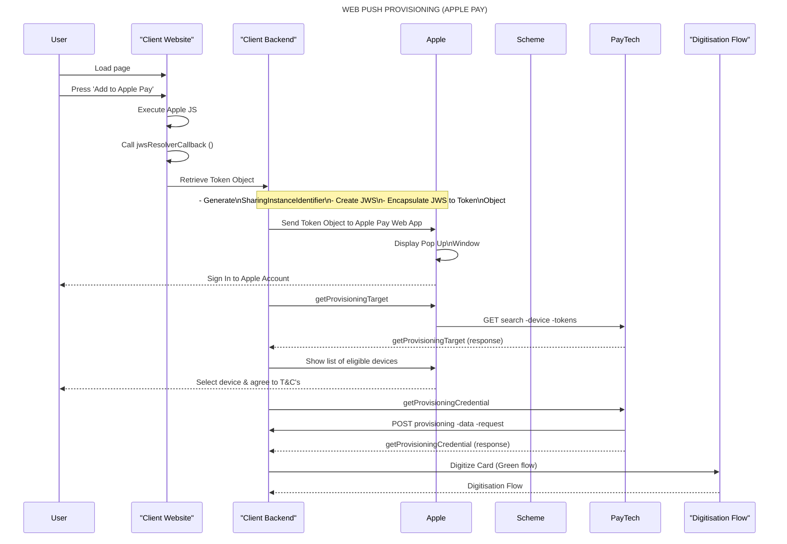

 

<ContentModal
  label="Open Example Modal"
  title="Example Modal"
  modalId="exampleModal"
  buttonColor="#2B6CB0"
  buttonPadding="12px 18px"
  size="sm"
  content={
    <HTMLBlock>{`
    Lorem ipsum dolor sit amet, consectetur adipiscing elit. 
    Fusce vel leo ut turpis feugiat commodo et in nunc. Phasellus imperdiet ut nunc vitae porta. 
    Pellentesque sollicitudin, sapien sed dictum molestie, dolor enim vestibulum est, non facilisis libero nibh vel arcu. 
    Fusce aliquam diam in velit vulputate luctus. Morbi sagittis erat eget est consectetur, a molestie dui sollicitudin. 
    Mauris commodo lorem eros, a cursus tortor malesuada ac. Ut sit amet eros dictum, aliquet nisl rutrum, finibus nulla. 
    Sed interdum commodo interdum. Quisque arcu diam, malesuada sit amet eros non, vulputate aliquet orci.
    `}</HTMLBlock>
  }
/>

{user.MyVariable}

<Accordion title="My Accordion Title" icon="fa-info-circle">
  Lorem ipsum dolor sit amet, **consectetur adipiscing elit.** Ut enim
  ad minim veniam, quis nostrud exercitation ullamco. Excepteur sint
  occaecat cupidatat non proident!
</Accordion>

 

