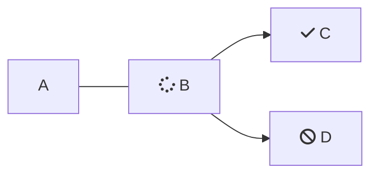

<SimpleStepper>
  <SimpleStep header="Step 1: Plan">
    Change copy.
  </SimpleStep>

  <SimpleStep header="Step 2: Write">
    Write effective and clear documentation.
  </SimpleStep>

  <SimpleStep header="Step 3: Review">
    Review and refine your content.
  </SimpleStep>
</SimpleStepper>

<Accordion title="My Accordion Title" icon="fa-solid fa-robot-astromech">
  This is the accordion.
</Accordion>

 

